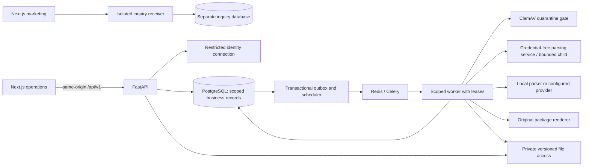

# Architecture

Updated: November 1, 2026. The system is an insurance document intelligence and workflow platform with CGL as its first domain implementation. This document separates the running architecture from the intended extension boundary.

## Running system

The repository uses a modular monolith with asynchronous workers. It does not implement a general plugin loader, microservice mesh, vector database, or autonomous agent runtime.

The diagram shows logical responsibilities. Full Compose parsing runs in a separate credential-free container on a worker-only internal network; native tests without a parser endpoint retain an in-process fallback. Hosted sandbox acceptance remains open. PostgreSQL holds identity and business data in the same database with separate restricted access paths.

| Area             | Current implementation                                                                                                               |
| ---------------- | ------------------------------------------------------------------------------------------------------------------------------------ |
| Web              | Next.js, React, TypeScript; separate `apps/web` operations and `apps/marketing` public builds; operations-only same-origin API proxy |
| API              | FastAPI in `services/backend/app`; strict Pydantic contracts; session-derived tenant scope                                           |
| Persistence      | PostgreSQL, SQLAlchemy, Alembic; tenant foreign keys, forced RLS, immutable evidence/review history                                  |
| Identity         | Local password/TOTP/recovery or server-side OIDC adapter; opaque sessions and context binding; live provider acceptance pending      |
| Async processing | Celery/Redis, database jobs/outbox, scheduler, bounded attempts and expiring leases                                                  |
| Files            | Private shared filesystem for local Compose; configured S3 adapter with version-addressed access, pending hosted validation          |
| Intake           | Quarantine/ClamAV, bounded pypdf/openpyxl parsing, PDFium/Tesseract OCR                                                              |
| Extraction       | Explicit-label parser by default; optional OpenAI Responses and approved HTTPS gateway adapters                                      |
| Output           | ReportLab/openpyxl original PDF/XLSX and supporting ZIP; deterministic narrative and sealed manifests                                |

`compose.full.yaml` runs the review product, `compose.database.yaml` provisions local PostgreSQL, and `compose.yaml` is a health-shell smoke setup. Staging, production, and non-synthetic mode fail closed.

## Dependency boundary

The target dependency direction is web/API → shared application services → domain contract, with a selected line implementation supplying insurance rules. Storage, queues, extraction vendors, and renderers sit behind infrastructure interfaces. Shared services must not import a concrete CGL schema to decide general workflow behavior.

Current CGL dependencies are visible in `app/domain/cgl.py`, `documents.py`, `workflow.py`, `rendering.py`, API contracts, and review UI. Preserve working behavior while moving these dependencies behind a small contract as relevant features are changed. Do not claim the module boundary already exists or perform a repository-wide rename just to make terminology generic.

| Shared responsibility                                     | Domain implementation supplies                                                           |
| --------------------------------------------------------- | ---------------------------------------------------------------------------------------- |
| Intake, file safety, source-block persistence             | Supported document/segment classifications and domain hints                              |
| Provider invocation, budgets, retries, schema enforcement | Field registry, typed extraction schema, prompts, normalizers, semantic validators       |
| Comparison execution and finding lifecycle                | Compatibility/grouping rules, discrepancies, permitted calculations, materiality         |
| Readiness and exception workflow                          | Versioned submission requirements, applicability, nonwaivable rules, permitted omissions |
| Review persistence, provenance, revision freezing         | Typed canonical payload and field labels/editor metadata                                 |
| Package sealing, approval, download/export                | Forms/exhibits, layout, narrative rules, output content and rights                       |

## Proposed line contract

This is a design requirement, not an existing API. A line module should be selected by a server-controlled `line_key` and expose:

- A versioned schema/field registry for candidates and canonical facts, plus presentation metadata.
- Extraction instructions/schema and deterministic validation of values, contexts, and source support.
- Context comparison/grouping and reconciliation rules producing explainable findings.
- A requirements profile producing blockers, permitted exceptions, and their disclosure text.
- Canonical payload validation and package-content/template definitions.
- A version manifest and domain fixtures/evaluation cases.

Use an explicit in-process registry when needed; do not execute uploaded code or accept arbitrary module names from clients. Resolve and pin schema, parser, prompt, rules, requirements, template, and renderer versions for each run/revision/package. Unknown lines or unavailable versions must fail explicitly. Never fall back silently to CGL.

Shared review mechanics own actor attribution, concurrency, revisions, exception authorization, and approval hashes. The selected domain owns whether two values are comparable or an omission is permitted. A UI can render generic evidence and tasks while using domain metadata for editors and schedules.

## Processing and consistency

1. Upload creates a private immutable version, job, audit event, and outbox entry with tenant scope. Server-generated keys and content hashes identify files; filename is display metadata.
2. A worker claims a lease and checks tenant, actor, job state, and source identity. Scanning gates normal document parsing. Redis is transport; PostgreSQL is the job source of truth.
3. Bounded parsing commits source blocks and processing inventory before extraction. Recoverable page failures preserve usable content; retries reuse established sources. Full Compose uses the separate credential-free parser service. Durable per-page checkpoints and independent hosted isolation acceptance remain open.
4. Extraction yields unverified observations. Strict schema, context, and source-association checks reject or flag unsupported output. Uninterpreted content stays in completeness accounting.
5. Domain reconciliation produces explainable findings. Review checks row versions and evidence fingerprints before appending decisions. A correction's original citations are history unless separately validated as its current support.
6. Readiness validates required facts, all source outcomes, and authorized exception dispositions. A revision freezes the reviewed payload and provenance.
7. Rendering freezes the source inventory and emits artifacts. A database seal protects the final manifest. Approval locks the submission and current membership, validates freshness/integrity, and binds exact hashes. Export returns those bytes.

Business writes and outbox events commit together. Workers verify their lease attempt before committing, so duplicate delivery cannot complete extraction twice. Creation APIs use tenant-scoped idempotency keys bound to request hashes; concurrent equal keys serialize. Review/settings use optimistic row versions. These are separate controls and do not implement resumable upload.

New evidence, source exclusion/replacement, changed review, or changed requirements must invalidate current eligibility and require a new revision/package where material. Historical decisions, packages, and approvals remain attributable. Closed/cancelled workspaces reject material edits. Renewal candidates never inherit approval.

## Contracts and code ownership

- Python/Pydantic owns domain validation and API contracts. `make contracts` generates `packages/contracts/openapi.json` and `api.d.ts`; do not hand-edit generated files.
- `app/database/models.py` owns identity/tenancy/audit/outbox metadata; `app/domain/models.py` currently contains both shared workflow and credential models. [DATA_MODEL.md](DATA_MODEL.md) describes that physical layout.
- `app/identity.py` owns session and permission resolution; `database/runtime.py` scopes business transactions.
- `app/documents.py` owns current parsing/extraction; `app/worker.py` owns dispatch/leases; `app/workflow.py` owns reconciliation/review/readiness; `app/rendering.py` owns original output generation.
- New shared infrastructure belongs outside concrete CGL rules. Do not create empty frameworks or speculative schemas for future lines.

Record material implementation choices in `docs/decisions/`. Schema evolution uses explicit Alembic migrations and versioned snapshots, never rewriting immutable evidence to fit a new schema. Promote normalized domain projections only when actual query/workflow needs justify them.

## Operational boundary

Local backup/restore, queue recovery, and configuration procedures are in [operations](operations.md). Production identity, independent assessment of hosted parser isolation, infrastructure encryption/IAM, observability, deletion/holds, and external vendor validation remain release work. An adapter's existence does not prove its deployment controls. See [SECURITY.md](SECURITY.md) and [ROADMAP.md](ROADMAP.md).

## Web platform expansion

[ADR 0004](decisions/0004-web-platform.md) records the independent runtime/network boundaries, OIDC flow, agency activation, manual subscription model, resumable intake and parser isolation. [Web platform operations](web-platform-operations.md) documents routes, configuration, local deviations and open acceptance. Marketing runs without operations credentials; inquiry storage defaults to a separate local SQLite volume and supports a dedicated PostgreSQL URL. No hosted or payment service is connected by this change.
