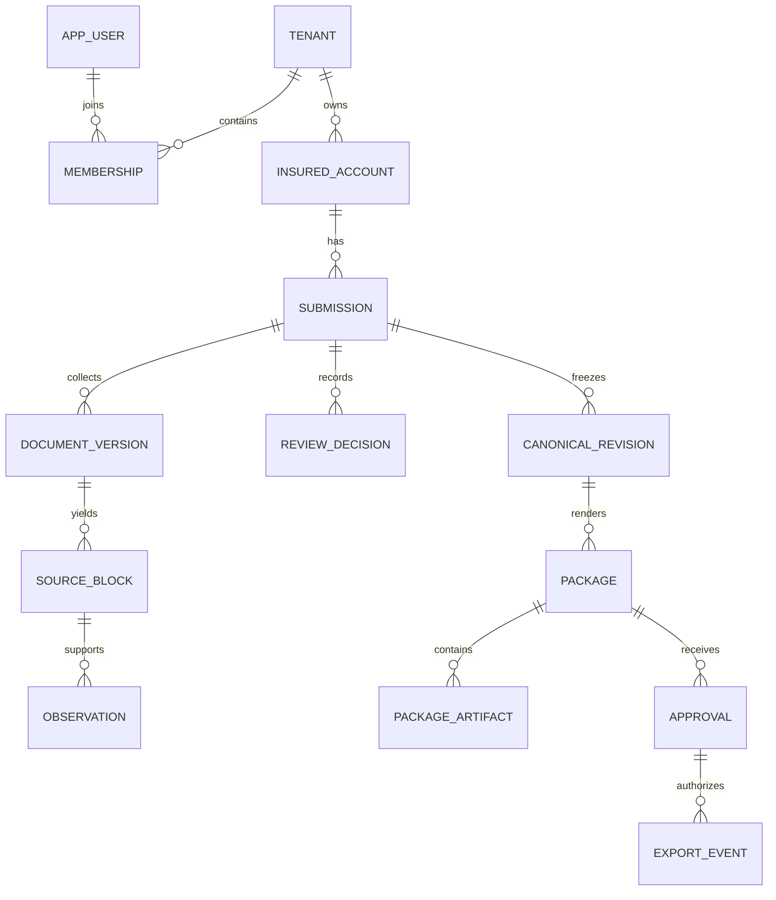

# Data model

Updated: November 1, 2026. This document describes actual persistence and the intended separation between shared workflow records and line-specific insurance facts. SQLAlchemy models and Alembic migrations are authoritative for physical schema; this document does not create tables.

## Ownership and relationships

An agency is a tenant. A user can have memberships in multiple tenants; permissions attach through membership role bundles. A tenant owns insured accounts and submissions. Each submission currently supports one line (`cgl`) and one intended period, with optional renewal lineage.

This is a simplified logical diagram. Observations can cite multiple blocks; review decisions can use validated evidence or attributed attestation. Refer to migrations for all constraints and foreign keys.

Business records carry `tenant_id`. Tenant-scoped relationships use composite references where defined, and forced RLS constrains runtime access. UUID possession is never authorization. Identity tables have a distinct restricted access path; do not apply tenant-business access assumptions indiscriminately to global users or credentials.

## Current shared persistence

Identity/tenancy metadata lives in `services/backend/app/database/models.py`; workflow models currently live in `app/domain/models.py` even where their responsibilities are shared.

| Actual table(s)                                            | Purpose and important fields                                                                                                                                             |
| ---------------------------------------------------------- | ------------------------------------------------------------------------------------------------------------------------------------------------------------------------ |
| `tenant`, `app_user`, `membership`                         | Agency/user identity, membership status, versions; issuer/subject bind the OIDC adapter without automatic email linking; verified-email status supports activation       |
| `role`, `permission`, `role_permission`, `membership_role` | Permission bundles, tenant-bound assignments and attribution                                                                                                             |
| `invitation`, `auth_session`                               | Expiring hashed invitations, session secret/CSRF hashes, MFA state, active agency and revocation                                                                         |
| `credential`, `recovery_code`, `oauth_state`               | Local password/TOTP/recovery data and single-use browser-bound OIDC state, nonce, PKCE verifier and return path; live provider acceptance pending                        |
| `insured_account`                                          | Tenant account display/profile information, external reference, status and row version; account metadata is not automatically reviewed named-insured evidence            |
| `submission`                                               | Account, `line`, kind, intended/loss-required periods, owner/due date, status, `input_version`, `row_version`, requirements and unverified renewal candidates            |
| `document_version`                                         | Submission, replacement link, file metadata, SHA-256, private object key/version, scan/processing status, classification, exclusion attribution and processing inventory |
| `source_block`                                             | Immutable document reference, locator JSON, text and parser version                                                                                                      |
| `observation`                                              | Immutable candidate field/value/context/raw value, primary/supporting source IDs, grouping key, method/pipeline, warnings, availability and support status               |
| `processing_job`, `outbox_event`                           | Scoped work, actor, stage/status, attempts/lease/error metadata and durable event dispatch                                                                               |
| `discrepancy`                                              | Current finding, input fingerprint, rule version, candidate references and resolution metadata; not an immutable canonical fact                                          |
| `review_decision`                                          | Immutable ordered decision, selected/corrected value/context, evidence fingerprint, reviewer, reason and support origin                                                  |
| `canonical_revision`                                       | Immutable numbered snapshot, input version, schema version, creator and hash                                                                                             |
| `package`, `package_artifact`                              | Frozen revision/source manifest, template, sealed manifest hash, private artifact versions/hashes and formats                                                            |
| `approval`, `export_event`                                 | Attributed approval of revision/manifest and subsequent approved artifact exports                                                                                        |
| `work_item`                                                | Follow-up question/task, assignee, due date, resolution reason and optimistic version                                                                                    |
| `audit_event`                                              | Append-only attributed action history with request/object references and minimal summary                                                                                 |
| `usage_event`, `idempotency_record`                        | Scoped processing/measurement metadata, unknown or estimated cost, and logical operation key/request hash/result binding                                                 |

There are no normalized canonical policy, exposure, coverage, or claim tables today. Reviewed CGL facts live in immutable JSON snapshots. Source segments and extraction-run metadata are currently represented within inventories/metadata rather than a complete normalized segment/run schema. Do not invent existing tables from the broader design in `plan.md`.

## Fact and provenance contract

Keep these layers distinct: original bytes → parsed source blocks → extracted observations → human decisions → canonical revision → rendered artifacts → approval/export. A later layer references its inputs; it must not overwrite them.

Each material fact needs a stable field key, typed value, original representation where supplied, context, availability, evidence-support state, review lineage, and version metadata. Document-derived facts cite exact source versions/locations; attestations name the actor, origin, and reason; calculations identify approved inputs and rule version. Support for one value or context cannot be reused automatically for a correction.

Current CGL field keys such as `coverage.each_occurrence` and `exposure.amount` resolve within the CGL registry. For future modules, identity must include `(line_key, schema_version, field_key)`; renaming current field strings alone is insufficient. Snapshots already carry schema/profile version metadata, but complete module-version binding remains architecture work.

Availability, support, and review are independent dimensions. Current observations use `available`, `unknown`, `not_applicable`, `not_supplied`, and `unreadable` availability states; absent expected fields also become readiness findings. Support includes `supported`, `unsupported`, and migration-era `legacy_unvalidated`. Review is recorded by decisions rather than replacing the raw candidate. See source enums/validators before changing wire values; the original plan's conceptual state names are not all current API literals.

Locators preserve PDF page/text-line or spreadsheet sheet/cell-range context. Spreadsheet parsing retains formats, formula/cached-value context, hidden rows/columns, and merged ranges in processing data. Reliable PDF/OCR geometry overlays remain open. A source ID that resolves is necessary but does not by itself establish semantic support.

## CGL payload and remaining domain design

`app/domain/cgl.py` currently defines `Context`, `Claim`, `FIELD_LABELS`, and validation/grouping rules. Context includes scope, existing/requested/historical/actual/estimate role, basis, unit, currency, period/as-of, policy reference, classification system, and optional entity/location IDs.

| Domain area                | Current representation                                                                                                                  | Required evolution / constraint                                                                                                          |
| -------------------------- | --------------------------------------------------------------------------------------------------------------------------------------- | ---------------------------------------------------------------------------------------------------------------------------------------- |
| Insured/entities/locations | Account profile plus reviewed identity/operations/location facts with grouping IDs                                                      | Full entity/operation/location relationships and schedules require domain-approved design; similar names cannot merge entities           |
| Exposures                  | `exposure.amount` plus basis, quantity, unit/currency, period, role and scope                                                           | Preserve supplied gross/net components, rating denominators, classification edition and overlap semantics; do not default to sales       |
| Policy/coverage            | Typed CGL field registry with policy/role context, limits, trigger, deductible/SIR, endorsements and supplied wording                   | Detailed aggregate/retention applicability, form editions and claims-made details remain incomplete; current/requested never collapse    |
| Claims/loss reports        | `loss.claim` typed object with carrier/policy/claim ID, dates/status, paid/reserves/incurred and valuation; report-period/no-loss facts | Full component/recovery semantics and separate claim-versus-valuation projections remain future work; no automatic summing of valuations |
| Requirements/output        | Provisional `cgl-synthetic-2` profile, CGL snapshot versions and original templates                                                     | Domain sign-off and applicability are required; schema defaults in historical models are not a universal active-version registry         |

Monetary values use exact decimal strings/Decimal, never binary floating-point. Monetary exposures normalize to `unit=money` with explicit currency. An unqualified dollar sign does not establish USD. Zero is valid only when explicitly supported; missing remains missing. No silent currency conversion, annualization, incompatible sums, or automatic incurred calculation.

## Revisions, concurrency, and integrity

- `row_version` protects editable records from lost updates; review also binds an evidence fingerprint. Idempotency records protect logical creation retries, scoped to tenant/operation and request hash.
- `input_version` tracks the material input set; revision numbers identify immutable reviewed snapshots. Replacing/excluding evidence or changing decisions invalidates current eligibility, while old rows remain historical.
- Renewal candidate JSON retains prior revision/hash/fact lineage but confers no current verification or approval.
- Document content identity, source blocks, observations, review decisions, revisions, artifact identities, approvals/exports, and audit history have application/database immutability protections. Document processing metadata and unsealed package state have controlled transitions; immutability does not mean every column in those tables is fixed at insert.
- Package manifests freeze source inventory, selected versions and hashes, snapshot identity, template, exceptions, and artifact hashes. Approval/export must recheck integrity and currentness. SHA-256 proves byte identity, not correctness or professional authority.
- The runtime role cannot rewrite history. Authorized retention/deletion must use an explicit maintenance workflow; append-only application controls are not tamper-proof against database owners.

## Schema evolution

Evolve through additive, reviewed Alembic migrations and explicit domain/schema versions. Preserve readable historical snapshots, source locators, and old approvals. Reprocessing appends new results and reopens affected review; it never retroactively blesses legacy observations. The review-remediation migrations through `0006_workspace` mark old observations unvalidated and invalidate affected inputs without rewriting immutable facts.

Before enabling a second line, bind its versions explicitly across submission, extraction, canonical payload, rules/requirements, and rendering. Add typed domain projections only for demonstrated needs, referencing their canonical revision and preserving provenance. Shared tenancy, source identity, and approval records must survive any such projection change.

## Agency platform records (migration 0007)

- `agency_profile`: one per tenant, contact details, versioned onboarding acknowledgments and completion time.
- `agency_subscription`: one per tenant, manual status/plan, billing contact, seat/submission limits, optional expiry and optimistic version. No payment credentials or fabricated invoice state.
- `billing_request`: append-only tenant requests attributed to a membership.
- `agency_activation`: operator-issued token hash, verified email binding, expiry, consumption/request hash and resulting tenant. Restricted definer functions perform activation; runtime cannot read activation secrets.
- `upload_session`, `upload_part`: tenant/submission/initiator binding, expected complete-file hash and byte count, expiry, immutable object references, part hashes and finalized document linkage. Expired/aborted parts currently remain stored.
- `auth_session`: context version, authentication time and last activity support session rotation, idle expiry and recent-authentication checks. Context references bind tenant plus session plus version.
- `app_user.email_verified` and the expanded `oauth_state` support server-side managed identity. They do not prove live provider lifecycle acceptance.

The `billing_admin` role grants billing/usage/agency metadata access without insured/document/review permission. New owners receive it plus `tenant_admin`; CGL preparer/approver roles remain explicit. The separate public inquiry database is outside the operations metadata and RLS schema. See [ADR 0004](decisions/0004-web-platform.md).

## Explicit version writes (migration 0008)

New canonical revisions set `schema_version` explicitly to the CGL schema version used by their snapshot. Snapshots also record the reconciliation `rule_version` alongside the requirements profile. Recomputed conflict findings set the active CGL rule version; accepted missing-information findings record the requirements-profile version that authorized their disposition. The database no longer supplies `cgl-1` defaults for these two columns: omitted versions fail instead of silently mislabeling new work.

Migration `0008_versions` changes defaults only. It does not rewrite historical snapshots, columns, hashes, packages or approvals. Pre-fix revisions can retain a `cgl-1` column with a `cgl-2` snapshot; interpret them with that known limitation and preserve the mismatch as history. This correction is not a complete per-run parser/prompt/domain/template version registry. See [ADR 0005](decisions/0005-audit-boundaries.md).
