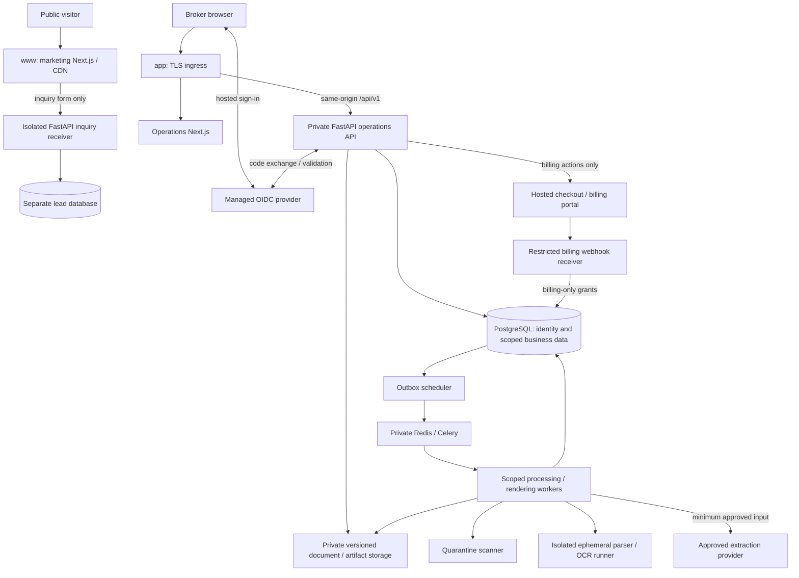

# Secure web platform architecture and implementation plan

Designed October 31, 2026. Status: **local synthetic platform implemented and workflow verified November 1, 2026; hosted integrations and release acceptance remain open**.

The user approved implementation after this plan was drafted. That authorization covers local implementation and verification; it does not authorize public deployment, customer-data use, paid services, or external messages. Existing synthetic-only and local/test restrictions continue to apply. The current implementation is described in [architecture](ARCHITECTURE.md), [data model](DATA_MODEL.md), [security](SECURITY.md), and [review remediation](review-remediation.md).

## Implementation record

The separate marketing/operations applications, isolated inquiry intake, OIDC adapter, controlled agency activation/onboarding, billing role/manual subscriptions, session/agency context binding, resumable uploads and credential-free parser service are implemented for local verification. See [local operation and remaining acceptance](web-platform-operations.md) and [ADR 0004](decisions/0004-web-platform.md). Hosted identity/payment services and release gates remain open. The current-code findings below record the pre-implementation baseline; they are retained as design rationale, not a statement that new components are absent.

## Recommended direction

Build two distinct experiences in one repository:

- `www.<domain>`: a public marketing website that explains the product and collects demo, pricing, and contact inquiries.
- `app.<domain>`: an authenticated, multi-employee agency application for insured accounts, CGL submissions, renewals, document processing, reconciliation, review, approval, export, and administration.

Use two Next.js applications with independent builds, runtimes, credentials, and deployment policies. Keep the existing `apps/web` as the operations application and use the new `apps/marketing` application. Share actual design primitives where useful. This preserves one codebase and stack while giving the public site a runtime with no insurance-system credentials or document access.

FastAPI remains the business authority. PostgreSQL remains the transactional source of truth. Documents and generated artifacts remain in private, immutable, version-addressed storage. Processing and AI calls run on the server through scoped jobs. Managed OIDC supplies hosted authentication; application memberships supply agency authorization.

The required customer outcome remains: **Upload the documents. Identify missing or conflicting underwriting information. Review the facts. Generate a submission-ready package.** Generation produces a candidate. An authorized broker must approve the exact package before normal export. Carrier submission remains manual.

## Current baseline and scope changes

| Area                      | Current repository                                                                                           | Proposed change                                                                                   |
| ------------------------- | ------------------------------------------------------------------------------------------------------------ | ------------------------------------------------------------------------------------------------- |
| Website/application       | One Next.js app contains public pages, login, invitations, and a client-routed workspace                     | Separate marketing and application builds, layouts, navigation, hosts, and policies               |
| Identity                  | Local passwords, TOTP/recovery, opaque sessions; OIDC settings and state storage are reserved                | Connect managed OIDC, verify ownership and MFA, and add controlled activation/onboarding          |
| Agencies                  | Tenants, multi-agency memberships, four role bundles, invitations, current-permission checks                 | Keep this model; add onboarding and billing administration without implicit broker authority      |
| CGL workflow              | Substantial synthetic intake-to-approved-export functionality with open acceptance requirements              | Preserve it and complete the existing domain, intake, evidence, and durability gaps               |
| Backend/data              | FastAPI modular monolith, forced PostgreSQL RLS, outbox, Celery/Redis, private local files and an S3 adapter | Retain the architecture; validate hosted storage and introduce independent parser isolation       |
| Commercial administration | Usage records exist; subscriptions, payment collection, and public lead intake do not                        | Add an agency subscription/entitlement model, a billing page, and bounded public inquiry handling |
| Release                   | Local/test and fictional documents only; staging/production fail closed                                      | Keep the gates until their evidence and separate release authorization exist                      |

The existing [product requirements](PRODUCT_REQUIREMENTS.md#non-goals-and-release-constraints) place billing outside the current build. The approved request expands that scope to subscription administration. Manual subscription records and limits are now implemented; payment processing and prices are not approved or connected. The [roadmap](ROADMAP.md) and [pilot gates](pilot-readiness.md) also leave managed identity, production operations, representative CGL evaluation, and commercial acceptance open.

The approved local implementation updates the canonical product, architecture, data, security, roadmap, and implementation documents and records the adopted boundaries in ADR 0004. Proposed hosted integrations below remain future work and do not waive any acceptance requirement from [plan.md](../plan.md).

## Deployment and service architecture



These are trust and deployment boundaries, not a plan for a general microservice framework. Keep the insurance application a modular monolith. Inquiry and webhook ingress can use small entrypoints in the backend repository, deployed with narrower routes and credentials. Their deployment identities cannot use the operations API's business connection.

| Component                    | Responsibility and access                                                                                                                                                                                                                                           |
| ---------------------------- | ------------------------------------------------------------------------------------------------------------------------------------------------------------------------------------------------------------------------------------------------------------------- |
| Marketing deployment         | Static/public rendering and approved content. No agency sessions, insurance API upstream, insurance database, document store, AI keys, or app telemetry SDK. Public static assets can be cached.                                                                    |
| Inquiry receiver             | Accept a closed contact schema, throttle abuse, and persist minimal leads. Use a separate database and leads-only role, potentially on the same managed PostgreSQL cluster. No business-table grants, document uploads, object-store credentials, or document jobs. |
| Application ingress          | Route the exact app host to Next.js and `/api/v1` to FastAPI; stream bounded uploads/downloads. Validate hosts and trusted forwarding headers. Reject unknown hosts and unconfigured upstreams.                                                                     |
| Operations Next.js           | Application layouts, server-side session checks, page rendering, and the typed API client. No direct SQL, AI invocation, or private object access. Server rendering forwards credentials only to the configured internal API.                                       |
| Operations FastAPI           | Identity/session lifecycle, membership/permission checks, tenant scoping, CGL workflow, signed-off entitlements, uploads, review, revisions, approval, audit, and authorized file streaming.                                                                        |
| PostgreSQL                   | Existing identity and business records with separate restricted access paths. Non-owner runtime, forced RLS, transaction-local scope, tenant-bound references, immutable history, and additive migrations remain mandatory.                                         |
| Storage                      | Separate private quarantine, source, and artifact areas; immutable keys and recorded object versions/hashes. Hosted encryption, IAM, versioning, holds, lifecycle, and restore must be validated.                                                                   |
| Scheduler/queue/workers      | Database outbox/jobs remain authoritative; Redis transports references. Bounded attempts, leases, heartbeats, tenant/job authorization, durable partial results, and idempotent completion.                                                                         |
| Parser/OCR runner            | Per-job ephemeral filesystem and only the selected input. No database, identity, AI, or general storage credentials; no outbound network. CPU, memory, time, page/cell, and output limits.                                                                          |
| Extraction provider boundary | Server-selected provider/model/schema; restricted egress, approved data terms and budgets, minimized input, strict output validation. Uploaded instructions cannot select endpoints or tools.                                                                       |
| Billing webhook receiver     | Public machine endpoint, potentially `hooks.<domain>/billing`, with signature/replay checks and billing-only database grants. No browser session authority, document access, or package permissions.                                                                |
| Internal operator access     | Private staff-authenticated tooling for lead qualification, agency activation, entitlements, and operational metadata. Dedicated staff roles, MFA, reasoned audit, and narrow provisioning operations; no implicit insured-document access.                         |

Use managed container hosting, managed PostgreSQL with point-in-time recovery, private Redis, private object storage, and managed secrets for a future hosted environment. An orchestrator such as Kubernetes is unnecessary for this scope. Cloud account, region, provider contracts, capacity, recovery objectives, and costs must be approved before provisioning. Separate environments need separate data, buckets, identities, keys, and queues; customer data must never populate development fixtures or preview deployments.

## Boundaries between the website and application

| Boundary         | Required behavior                                                                                                                                                                                                                                                                                   |
| ---------------- | --------------------------------------------------------------------------------------------------------------------------------------------------------------------------------------------------------------------------------------------------------------------------------------------------- |
| Domains          | Apex redirects to the canonical marketing host. Marketing sign-in links navigate to `https://app.<domain>/login`. The app root selects login, agency selection, onboarding, or dashboard. Marketing never renders an agency-specific signed-in header.                                              |
| Sessions         | Host-only app cookies; no `Domain=.<domain>`. Marketing neither receives nor reads app sessions. OIDC callbacks terminate on the app host.                                                                                                                                                          |
| Routing          | Public-host requests to `/workspace`, `/insureds`, `/submissions`, or `/api/v1` return a public 404. Only fixed legacy login/invite paths may redirect to the canonical app flow. No broad API rewrite or arbitrary `returnTo` forwarding.                                                          |
| Authorization    | Every FastAPI data action independently validates session, active membership, permission, and record ancestry. Next.js route checks improve navigation but cannot authorize data access.                                                                                                            |
| Browser origins  | Business calls stay same-origin on the app host. Do not allow credentialed marketing-to-app CORS. Sibling subdomains are not trusted origins for unsafe app actions.                                                                                                                                |
| Caching          | Marketing can use public CDN caching. Authenticated HTML, RSC payloads, API responses, source views, and artifacts use `Cache-Control: private, no-store` and bypass shared caches. Fingerprinted code/static assets may be cached. No offline document cache or service worker stores agency data. |
| Analytics        | Marketing conversion events contain no insured or submission information. App diagnostics contain minimal operational identifiers and redacted errors; no ad pixels, session replay, document text, provider bodies, or cross-site identity joins.                                                  |
| Search           | Approved marketing pages get their own canonical metadata, sitemap, and index policy. App/auth/invite pages get `noindex` and `X-Robots-Tag`; indexing controls do not substitute for authentication. Local/test remains non-indexable.                                                             |
| Shared code      | Share presentation primitives only when both apps need them. Marketing cannot import workspace components, auth clients, contracts with private fixtures, or server integrations. Enforce imports and inspect public build artifacts in CI.                                                         |
| Content security | App-specific CSP, output escaping, no executable upload content, `nosniff`, controlled referrers, and framing restrictions. External auth/payment flows use navigation to approved destinations. Public third-party scripts require their own review and cannot be loaded by the app.               |

Next.js route groups organize layouts and do not change URL paths; they do not provide runtime or data isolation. Next.js also recommends checking authorization close to data access. These constraints motivate the separate builds and backend enforcement above. [Route groups](https://nextjs.org/docs/app/api-reference/file-conventions/route-groups), [Next.js authentication guidance](https://nextjs.org/docs/app/guides/authentication).

OWASP notes that sibling subdomains can be considered the same site by the browser. Accordingly, this design requires exact app Origin checks and session-bound CSRF protection as well as cookie attributes. [OWASP CSRF guidance](https://cheatsheetseries.owasp.org/cheatsheets/Cross-Site_Request_Forgery_Prevention_Cheat_Sheet.html).

## Public marketing page structure

Public navigation: Product, How it works, Security, Pricing, Request a demo; secondary Sign in. Footer: Contact, Privacy, Terms, and verified security contact information.

| Route                          | Content and conversion purpose                                                                                                                                                                     |
| ------------------------------ | -------------------------------------------------------------------------------------------------------------------------------------------------------------------------------------------------- |
| `/`                            | Product promise, target agencies, fictional workflow preview, supported CGL scope, and primary Request a demo action.                                                                              |
| `/product`                     | Insured management, document intake, extraction with evidence, discrepancies, review, approval, and package output. Distinguish available behavior from planned features.                          |
| `/how-it-works`                | Upload → process → reconcile → review → generate → approve → export, using fictional screenshots or a static interactive demonstration. No anonymous access to the operations backend.             |
| `/solutions/general-liability` | Supported CGL document categories, exposure/coverage/loss review, renewals, and current limitations. No implication of support for additional lines.                                               |
| `/security`                    | Accurate data-flow and access explanations, AI/provider handling, retention/contact information, and current release posture. Publish certifications or infrastructure claims only when supported. |
| `/pricing`                     | Approved commercial packaging and a pricing inquiry action. Initially use “Contact for pricing”; no invented prices, savings, free trials, or checkout promises.                                   |
| `/request-demo`                | Name, work email, agency, optional team-size range and brief workflow question; clear notice to exclude insured details and documents. No file input.                                              |
| `/contact`                     | General inquiry form using the same bounded intake and purpose field; approved business and security contact information.                                                                          |
| `/thank-you`                   | Generic confirmation with no echoed personal details or public lead-status lookup.                                                                                                                 |
| `/privacy`, `/terms`           | Professionally reviewed notices and terms appropriate to the released service. Drafts must not be represented as approved legal text.                                                              |
| `/404` and error state         | Useful public navigation and retry guidance without internal details.                                                                                                                              |

The inquiry service accepts bounded plain text, validates field lengths, blocks file payloads, rate-limits and applies bot controls, and returns a generic receipt. Lead records are private personal data with a separate access/retention policy. Request-response consent and optional marketing opt-in are distinct. Qualifying a lead does not create an agency or grant application access. Initially, authorized operators review leads through restricted tooling; CRM/calendar/email integrations are separately configured work.

Measure demo form completion and qualified agency conversions. Publish only approved fictional demos or explicitly authorized materials. The current local parser and unvalidated optional AI adapters must not be marketed as proven general insurance understanding.

## Application page structure

The app has a compact identity layout and a separate operations layout. The operations shell shows the active agency, current user, role-appropriate navigation, processing notices, and breadcrumbs. Agency administration is available to administrators even when they have no document permissions.

| Route                                  | Purpose and access                                                                                                                                                   |
| -------------------------------------- | -------------------------------------------------------------------------------------------------------------------------------------------------------------------- |
| `/`                                    | Resolve authenticated landing state server-side.                                                                                                                     |
| `/login`                               | Start managed hosted authentication; no production local-password or fictional-demo button.                                                                          |
| `/auth/error`, `/recover`              | Safe authentication errors and provider-hosted recovery handoff. No account enumeration.                                                                             |
| `/activate`, `/invite`                 | Minimal activation/invitation landing and explicit acceptance after verified authentication. Tokens are never rendered into analytics or page metadata.              |
| `/select-agency`, `/access-pending`    | List only the user's active memberships, or explain pending/absent access without creating a tenant.                                                                 |
| `/onboarding`                          | Resumable, permission-aware agency setup checklist.                                                                                                                  |
| `/dashboard`                           | Due, blocked, processing, and awaiting-review work; owner filters and clear first-use actions. Only aggregate data the user may read.                                |
| `/insureds`, `/insureds/new`           | Search, create, and archive insured accounts; distinguish display metadata from reviewed underwriting evidence.                                                      |
| `/insureds/[id]`                       | Insured profile, associated submissions, renewal lineage, and account history.                                                                                       |
| `/submissions`, `/submissions/new`     | Submission queue and CGL new-business/renewal creation with account, period, owner, due date, requirements profile, and optional predecessor.                        |
| `/renewals`                            | Queue of CGL work approaching renewal, derived from supported submission/period records. Starting a renewal creates unverified candidates with prior lineage.        |
| `/submissions/[id]/overview`           | Business status, requirements, blockers, owners, due dates, and next actions.                                                                                        |
| `/submissions/[id]/documents`          | Upload/resume, versions, scan status, classification, replacements, exclusions, and completeness inventory.                                                          |
| `/submissions/[id]/processing`         | Per-document/stage progress, partial outcomes, failures, bounded retry, and unsupported content.                                                                     |
| `/submissions/[id]/reconciliation`     | Contextual identity, operations, exposures, coverage, and loss comparisons with explainable findings and source links.                                               |
| `/submissions/[id]/review`             | Evidence beside candidates; select, supported correction, attributed attestation, reject, omission proposal, and authorized exception disposition.                   |
| `/submissions/[id]/tasks`              | Follow-ups with owners, due dates, reasons, and attributable resolution.                                                                                             |
| `/submissions/[id]/package`            | Readiness, frozen revision, candidate generation, exact artifact/manifest preview, limitations, approval, and approved export.                                       |
| `/submissions/[id]/history`            | Source/review/revision/package/approval/export lineage. Superseded packages are clearly historical and require explicit acknowledgment for permitted retrieval.      |
| `/tasks`                               | Agency-scoped work assigned to or visible to the user.                                                                                                               |
| `/approvals`                           | Authorized approver queue with current readiness and package state.                                                                                                  |
| `/settings/agency`, `/settings/team`   | Agency profile, invitations, member status, fixed role assignments, and last-administrator protection.                                                               |
| `/settings/security`                   | Agency MFA/session policy and access review. Provider-specific settings shown only when supported.                                                                   |
| `/settings/billing`, `/settings/usage` | Subscription, billing contacts, plan/period/limits, invoices, usage and payment portal or manual-plan controls; billing permissions required.                        |
| `/settings/data`                       | Retention policy, legal-hold/deletion request status, offboarding and data-return requests. Destructive operations use a separately authorized maintenance workflow. |
| `/profile`, `/profile/security`        | Personal display settings, provider-managed MFA/recovery, active sessions, and revocation.                                                                           |

Authentication callbacks are backend routes under the app's same-origin `/api/v1/auth/...` ingress, not public marketing pages. Browser routes and proposed endpoints in this document are a target contract; they do not exist merely because listed here.

Every data screen needs loading, empty, forbidden, stale/concurrent-edit, partial-failure, and recoverable error states as applicable. Preserve dirty-form protection and meaningful focus/keyboard access. Use visible text for missing/conflicting/unverified/reviewed states, not color alone. Responsive layouts must retain evidence access and approval details.

## Authentication and session flow

Use one approved managed OIDC provider with hosted sign-in, verified email ownership, mandatory MFA, recovery, audit, and supported revocation notifications. Prefer phishing-resistant factors where available. The provider authenticates users; it cannot assign application tenants or broker permissions from arbitrary profile claims.

```mermaid
sequenceDiagram
    participant B as Broker browser
    participant A as App / FastAPI
    participant I as Managed identity provider
    participant D as Identity database
    B->>A: Open protected app URL
    A-->>B: Login with safe relative return path
    B->>A: Start authentication
    A->>D: Persist short-lived browser-bound transaction
    A-->>B: Redirect with code flow, state, nonce, PKCE
    B->>I: Authenticate, verify ownership, complete MFA
    I-->>B: Redirect authorization code to exact app callback
    B->>A: Callback with code and state
    A->>I: Server-side code exchange
    A->>A: Validate transaction, token, identity and assurance
    A->>D: Resolve user, memberships and revocable session
    A-->>B: App-only opaque session; clean redirect
    B->>A: Request scoped page/data
    A->>D: Check live membership and required permissions
    A-->>B: Authorized minimal response
```

1. Preserve only an allowlisted relative app return path; no external or protocol-relative redirect targets. Private responses redirect to app login without exposing record details.
2. FastAPI creates a single-use, ten-minute authentication transaction bound to a browser cookie. Store state digest, nonce, PKCE verifier, intended flow, and safe continuation server-side. Do not place invitation secrets or document identifiers in provider-facing state.
3. Use authorization code flow with PKCE S256 and an exact registered callback. Exchange the code server-side through a maintained OIDC library. Validate issuer, signature/algorithm/key, audience/authorized party, expiry, nonce, transaction binding, verified email, and the provider-specific MFA assurance contract. Reject replay or insufficient assurance. [OAuth security BCP](https://www.rfc-editor.org/rfc/rfc9700.html), [OIDC validation](https://openid.net/specs/openid-connect-core-1_0.html#IDTokenValidation).
4. Identify a user by issuer and subject. Never auto-link accounts or join an agency by matching an email domain. Existing local synthetic identities retain their attribution and are not silently reassigned to new OIDC identities.
5. Create/rotate a revocable opaque app session after successful authentication. Tokens remain server-side; request no refresh token unless a documented server-side use requires one. The browser receives no provider bearer token for business APIs.
6. With no membership, allow only identity, activation/invitation, onboarding eligibility, and access-help functions. With one agency, select it; with several, show the selector. Check tenant status and live membership before entering operations.
7. Production cookie proposal: `__Host-app_session`, `Secure`, `HttpOnly`, `SameSite=Lax`, `Path=/`, no Domain. A host-only session-bound CSRF token accompanies unsafe requests with an exact trusted app Origin. Proposed session limits are 30 minutes idle and eight hours absolute, enforced server-side. These are product defaults for approval, not claims about current code. [OWASP session guidance](https://cheatsheetseries.owasp.org/cheatsheets/Session_Management_Cheat_Sheet.html).
8. Require authentication within the preceding ten minutes for package approval, exception acceptance, privileged role changes, billing changes, and deletion requests. Bind the resumed action to agency, object/version, and user intent; never auto-submit an outdated approval after reauthentication.
9. Logout revokes the local session and clears cookies. Offer revoke-other-sessions. Provider logout does not replace local revocation. Recovery or identity-disable events revoke associated sessions when authenticated notifications arrive; membership and tenant disablement are enforced by the app immediately on subsequent requests. Provider-event delivery/reconciliation must be tested; do not promise instant provider-side deprovisioning without it.

Keep local password/TOTP and signed fictional examples only in explicitly synthetic local/test mode. Hosted deployments cannot fall back to them when OIDC fails. Use a conformant test identity provider or mock issuer in isolated tests; no live identity account is provisioned by this plan.

### Agency switching and concurrent tabs

Initially retain one active agency per session. Switching is an authenticated, CSRF-protected operation that verifies the target active membership, rotates session/CSRF secrets, and increments an agency-context version. Every business request carries the agency/context version associated with the rendered page. FastAPI compares it with the session before entering tenant scope; it is a consistency precondition, never authorization.

An old tab receives an agency-context conflict and must reload before a write or download. Clear cached views, pending mutations and upload continuations on agency change; notify other tabs and discard responses from the previous context. Bind persisted retry keys and upload sessions to their original agency and request hash. Already accepted jobs stay bound to the recorded agency. Do not replay an old tab's operation against the newly selected agency. Record IDs from another agency return a non-disclosing not-found response.

## Agency onboarding and employee lifecycle

Start with sales-assisted, invitation-based onboarding. Public inquiries do not create live agencies. Self-service signup can be added after abuse controls, commercial terms, and customer-data onboarding are validated.

### First agency administrator

1. A prospect requests a demo on the marketing site. An authorized operator qualifies the agency, confirms the initial administrator and agreed scope, and records the onboarding authorization. Email ownership alone does not establish authority to represent an agency.
2. Create an expiring, single-use activation bound to the intended recipient and approved onboarding scope. It cannot bypass the environment/customer-data gates. In local/test, it can create only a fictional agency.
3. The recipient opens an app-host activation link and completes managed authentication, verified email, and MFA. Capture the secret on a minimal first-party page, exchange it for a short-lived browser-bound intent, then remove it from the URL. Prefer URL fragments for new links; redact legacy query tokens from all ingress logs. Never send secrets to analytics, error reporting, or the identity provider. Merely opening a link does not consume it.
4. Show the agency identity, service scope, versioned terms/privacy acknowledgment, administrator authority attestation, and document-upload responsibilities. Validate eligibility server-side and consume activation only on explicit acceptance.
5. In one idempotent transaction, create the tenant, administrator membership, onboarding record, initial subscription/entitlement record, acknowledgments, and audit/outbox records. Bind retries to recipient, activation, and request hash. Use a narrow provisioning operation, never a migration/admin database credential in a request.
6. Grant `tenant_admin` and explicitly confirmed billing administration. Broker preparation and approval require separate role grants. The first administrator can complete team setup without seeing insured records.
7. Complete a resumable checklist: agency profile/timezone and contacts; designated preparers and approvers; team invitations; approved CGL requirements profile and limitations; subscription/limits; security and data policies; first insured/submission. Store progress server-side. A sample workspace uses fictional data only.
8. Enable operations only when server-checked onboarding prerequisites and the environment's release authorization are satisfied. An unchecked marketing form or client-side setup flag cannot unlock uploads.

### Inviting employees

An agency administrator chooses a recipient email and explicit fixed role bundles. Invitation creation requires current membership, `members.manage`, available seat entitlement, and recent authentication for privileged grants. Store a token digest, recipient, tenant, inviter, expiry, role grants, and status. Proposed expiry is seven days; revoke/reissue invalidates the old secret.

The employee follows the app-host link, authenticates or creates an identity at the managed provider, verifies ownership/MFA, and explicitly accepts. Match the verified recipient, current agency eligibility, pending invitation and allowed role grants under a lock. Consume once and create/update only that agency membership. A user joining another agency gets another membership; invitation acceptance never creates a new agency. Recheck seat capacity transactionally at acceptance to handle concurrent invitations.

Transactional email belongs to a narrowly configured server-side delivery adapter, with minimal invitation content and no underwriting data. Local/test uses a safe local capture mechanism. Live sending and provider configuration need separate authorization; this design sends nothing.

### Role and access model

Keep agency-wide insured/submission access for users granted the relevant document roles in the initial release. Ownership assigns work; it does not create private account access. Office, branch, team, and account-level restrictions require a separately designed and tested scope before being promised.

| Role bundle                           | Authority                                                                                                                                                                                                                                                  |
| ------------------------------------- | ---------------------------------------------------------------------------------------------------------------------------------------------------------------------------------------------------------------------------------------------------------- |
| Viewer                                | Read permitted insureds, submissions, sources, review, packages and applicable audit. No preparation, package approval, or normal export grant.                                                                                                            |
| Preparer                              | Viewer access plus account/submission work, uploads, reconciliation, supported review, task management, package generation, and export of a currently approved package. Cannot accept material exceptions or approve packages without the approver bundle. |
| Approver                              | Viewer access plus review, authorized exception acceptance, exact-package approval, and approved export. Does not automatically gain account/upload/package-generation administration.                                                                     |
| Agency administrator (`tenant_admin`) | Agency settings, team membership/roles, access review, administrative audit, usage and data-management requests. No implicit insured-document access or broker approval.                                                                                   |
| Billing administrator (new)           | Billing contacts, subscription/invoices/payment portal and billing usage. No insured-document, review, approval, or membership-management access.                                                                                                          |

Roles can be combined explicitly. An administrator may grant the approver bundle to a designated authorized broker, including themselves where agency policy permits; record the grantor, recipient, reason, time and recent authentication. The initial policy requires an explicit approver grant but does not require a different preparer and approver. Software permissions do not prove licensing or external customer authority. A mandatory two-person approval policy is a possible later requirement, not current behavior.

Disablement and role changes use optimistic versions, protect the last active administrator, recheck live authority, and append audit. Membership disablement blocks subsequent data requests, downloads, and sensitive actions without deleting attribution. Administrative audit payloads must not expose underwriting values to administrative-only users. Billing-only users see aggregated billing usage rather than insured names or document content.

Offboarding separates membership removal, subscription cancellation, agency suspension, data return, retention/holds and deletion. Security suspension blocks document access. Billing expiry alone follows the restricted-access rules below. Platform support cannot impersonate brokers or acquire document access by assigning itself an agency role. Any future exceptional support access needs explicit tenant authorization, a limited duration/purpose, and attributable audit.

## CGL operations, processing, and evidence

The website/application split must preserve the existing provenance chain:

**Original bytes → source blocks → unverified observations → attributed review decisions → immutable canonical revision → sealed package artifacts → exact-package approval → recorded export.**

1. Create or select an insured, then create a CGL submission with intended period, owner, requirements version, and new-business/renewal context. Reject unsupported lines explicitly. Renewals copy prior facts only as unverified candidates with lineage; prior approval does not carry forward.
2. Initialize a tenant/submission-bound upload session, transfer bounded chunks to private quarantine, and finalize once after byte-count/hash/type checks. Resume and finalize require current authority and original agency context. Expired/aborted parts are cleaned by a bounded maintenance job. Finalization atomically establishes the immutable source version, job, audit and outbox entry. The existing multipart/idempotency behavior remains until this genuinely resumable protocol is delivered.
3. Scan before trusted parsing. Scanner unavailability leaves the document quarantined. Do not allow an agency setting or filename to bypass scanning. Preserve excluded, failed, replaced, unreadable and unsupported sources in the inventory.
4. Run parsing/OCR within the independent per-job boundary. Validate its output before persisting blocks. Persist durable per-stage/page outcomes so retries retain usable work, including when a provider fails after parsing. Preserve native spreadsheet cell/formula/cache/hidden context and PDF/OCR geometry needed for evidence navigation.
5. Classify/segment with explicit broker overrides and reasons. Extract typed candidates through the chosen CGL schema and pipeline versions. Treat document text/provider output as data, never tools or instructions. A valid schema, confidence score, or resolvable citation does not establish semantic support or human approval.
6. Compare only compatible entity, location, policy, period, role, basis, unit, currency and scope. Keep current/requested/historical coverages and claim valuations distinct. Use exact decimal strings/Decimal, retain unknown versus zero, and avoid guessed classifications, currency, annualization or incurred calculations.
7. Review against exact source versions and locators. Corrections require newly validated support or an explicit attributed attestation; original citations remain history unless revalidated. Omission proposals require authorized acceptance and disclosure; nonwaivable blockers remain blockers. Protect concurrent decisions with versions and evidence fingerprints.
8. Freeze reviewed facts, requirements, source inventory, limitations and all relevant schema/pipeline/rules/template/renderer versions. Generate original PDF/XLSX/ZIP artifacts; preview the same immutable bytes intended for approval.
9. Approve only after current membership, recent authentication, readiness, input freshness, manifest and actual byte hashes are rechecked under the necessary locks. Any material source/review/requirements change invalidates eligibility and requires a new revision/package/approval. Preserve historical artifacts and approvals.
10. Authorize and record normal export of the approved bytes. No automatic email, carrier upload, submission transmission, coverage decision, rating, binding, or unlicensed form reproduction is added.

Keep business status separate from processing status. The target business sequence remains `draft → collecting → in_review → ready_for_package → awaiting_approval → approved → exported → closed`, with cancellation. A failed job cannot indicate business completeness. Do not equate a clear task list or successful model call with submission readiness.

Shared services own ingestion mechanics, citations, jobs, task/review lifecycle, permissions, revisions, manifests and export transport. CGL owns schema/field semantics, exposure/coverage/loss comparability, requirements, exceptions and output content. Extract the small explicit line boundary as related modules are touched; do not introduce another insurance line or an empty plugin framework.

### Job authorization and employee removal

Introduce narrowly scoped processing service principals with explicit tenant/job authorization. A queue message contains references, not authority or document bodies. Claim from durable database state and verify tenant, source, allowed action, principal, attempt and lease before each stage/commit. A restricted scheduler can enumerate dispatch metadata without reading underwriting content.

Record both the initiating member and executing service principal. Tenant suspension stops new work and prevents subsequent commits. If the initiating member loses the required authority, pause pending work and pause active work at the next bounded checkpoint until an authorized preparer adopts/requeues it. Retain completed evidence as history. Processing identities cannot review, attest, accept exceptions, approve packages, export, or send externally. These semantics are a proposed improvement over the current active-user worker model and require dedicated deprovisioning/race tests.

## Subscription administration

Subscriptions belong to the agency, not the individual employee or insured. Keep billing state independent of identity, tenant security status, and underwriting readiness. Entitlements can limit seats, new submissions, uploads, storage or processing budgets; payment cannot grant broker authority or waive blockers.

Design for both a manually administered pilot subscription and hosted commercial payments. The application billing page must show the current plan/source, status, period, limits, usage freshness, billing contact and available actions in either mode. Manual plans offer an attributable plan-change/cancellation request. They must not display a connected payment method or processor when none exists.

Recommend hosted checkout and a hosted customer portal for commercial payment details and invoices; keep card data outside this system. Stripe Billing is the proposed adapter, subject to vendor, contract, pricing and account approval. Its portal supports payment details, invoices, subscription changes and cancellation. [Stripe portal documentation](https://docs.stripe.com/customer-management).

| Subscription condition                                      | Proposed application behavior                                                                                                                                      |
| ----------------------------------------------------------- | ------------------------------------------------------------------------------------------------------------------------------------------------------------------ |
| Approved manual pilot / active                              | Allow the contracted capabilities within quotas and release scope.                                                                                                 |
| Trial                                                       | Enable only if an approved trial policy exists; no automatic public trial initially.                                                                               |
| Payment incomplete                                          | Show billing/setup actions; do not infer activation from a checkout return URL.                                                                                    |
| Past due                                                    | Display the issue and an explicitly configured contractual grace deadline. No unapproved automatic grace period.                                                   |
| Grace expired / expired / cancelled after paid-through date | Stop new submissions, uploads and processing; retain authorized read access and export of eligible already-approved packages during the agreed data-return window. |
| Security suspended                                          | Deny insured/document access independently of payment; follow the incident/data-return process.                                                                    |

Cancellation normally takes effect at the paid-through date under the approved agreement. It does not delete documents or historical approvals. Deletion/holds and customer data return follow separate policies. Final grace/return durations and plan prices require commercial approval before activation.

Authenticated billing actions check `billing.manage`, recent authentication, current agency context and server-owned customer/subscription mappings. Resolve plan/price/version from an approved server catalog; a browser-supplied price, customer ID or redirect cannot authorize another agency's billing session. Use creation idempotency for checkout/portal actions.

The webhook receiver verifies signature and timestamp against the raw body, validates live/test mode and configured account, deduplicates event IDs, and durably records receipt before asynchronous processing. Events can be delayed or out of order; reconcile against authoritative provider state before changing entitlement versions. Retry safely, maintain a dead-letter/reconciliation process and audit manual overrides. No webhook handler receives document-read or broker-approval grants. Stripe documents asynchronous subscription events and webhook handling requirements. [Subscription webhooks](https://docs.stripe.com/billing/subscriptions/webhooks), [Webhook documentation](https://docs.stripe.com/webhooks).

Usage metering separates a logical billable unit from retries, extraction attempts and package revisions. Do not double-charge platform retries. Define billable submissions/seats and revision windows with customers before charging; proposed pricing in the original plan remains unvalidated. Actual processing tokens/costs must be measured, and unknown costs remain unknown. Do not implement automatic overage charging until the unit, thresholds and customer consent are approved.

## Data and API evolution

Preserve the current tables and historical canonical JSON snapshots. Introduce only records required by the approved workflows; names below describe proposed ownership, not existing schema.

| Proposed record/change                            | Contents and access                                                                                                                                                                                                                                     |
| ------------------------------------------------- | ------------------------------------------------------------------------------------------------------------------------------------------------------------------------------------------------------------------------------------------------------- |
| Lead inquiry, in a separate lead database         | Minimal contact/purpose/consent/status data, anti-abuse metadata with approved expiry; inquiry receiver writes, authorized operators read. No insured linkage by default.                                                                               |
| Agency activation                                 | Recipient, token digest, expiry, operator authorization, environment/scope, consumption and retry binding. Narrow identity/provisioning access before a tenant exists.                                                                                  |
| Agency profile/onboarding and acknowledgments     | Tenant-bound agency contacts/setup progress, versioned terms/policies, actor/time/authority, approved onboarding scope.                                                                                                                                 |
| OIDC transaction/session evolution                | Browser binding, safe continuation, single-use consumption, provider assurance/authentication time, idle/absolute expiry, agency-context version and revocation. Reuse existing identity/session structures where appropriate with explicit migrations. |
| Billing account/subscription/entitlement snapshot | Tenant-bound provider mapping or manual source, approved plan/version/period/limits/status and optimistic version.                                                                                                                                      |
| Billing events/change requests                    | Provider event deduplication and processing state, narrow minimal payload, manual override/change/cancellation attribution. No retained card data or unrestricted raw vendor bodies.                                                                    |
| Upload session/parts/finalization                 | Tenant, submission, initiating member, content identity, progress, expiry and finalized document reference; finalization idempotency.                                                                                                                   |
| Service-principal/job authorization               | Explicit tenant/job grants, initiating and executing identities, current authorization version and lease/checkpoint attribution.                                                                                                                        |
| Permission catalog                                | Add billing-specific permissions and the billing administrator bundle; fixed agency roles otherwise remain.                                                                                                                                             |

All new tenant-owned records need forced RLS, tenant-bound references and least-privilege grants. Global identity, pre-tenant activation, lead intake and billing-event lookup require explicitly restricted access paths; adding them must not broaden the business runtime role or authentication connection to arbitrary table access. External event-to-tenant mappings are server-owned and inaccessible to public callers.

FastAPI/Pydantic remains authoritative. Continue `/api/v1` for the operations API. Proposed additions cover OIDC start/callback, activation acceptance/onboarding, sessions, invitation lifecycle, resumable upload init/chunk/finalize, billing overview/portal/checkout/requests, and usage. The public inquiry receiver has only its fixed inquiry route; the webhook entrypoint exposes only configured machine callbacks. Internal provisioning endpoints are never mounted on public/browser ingress.

Use explicit Alembic migrations and regenerate OpenAPI/TypeScript contracts with `make contracts`. Preserve idempotency/request-hash binding, optimistic versions, evidence fingerprints, transactional outbox and attempt/lease validation. Do not rewrite old source, review, revision or package records to fit new schemas. Typed lists and bounded/cursor pagination must cover the new queues and administration views.

### Transition from the existing routes

Keep current synthetic workflows runnable while the new layouts and explicit pages replace the catch-all workspace. Map app-host `/workspace` to `/dashboard`, `/workspace/insureds/...` to the corresponding insured pages, `/workspace/submissions/...` to submission overview, `/workspace/tasks` to `/tasks`, and `/workspace/settings` to the permitted settings landing. Do not resolve private identifiers or fetch records on the marketing host to perform redirects. Update security/product links in the app to the canonical marketing host.

Separate the current root metadata and stylesheet ownership so marketing can gain approved SEO without making app pages indexable. Marketing configuration must not import the operations configuration that currently requires `API_INTERNAL_URL`. Replace the broad shared rewrite with an app-only allowlisted ingress route. When introducing the new host cookie, explicitly expire legacy session/CSRF cookies at their original paths and require reauthentication; preserve user attribution and immutable workspace history.

Use additive migrations and compatible readers before switching each writer or route. Rehearse against disposable synthetic copies, verify old revision/package readability and exact hashes, and keep rollback compatible with the expanded schema. Do not reset the developer database, remove volumes, replace existing secrets, or run destructive downgrades to complete the transition.

## Security, privacy, and operations acceptance

The design extends the existing [security requirements](SECURITY.md); secure hosting remains an engineering and external acceptance task.

- Keep runtime and identity database roles non-owner and non-bypass; set tenant/user scope transaction-locally and test pooled connection reuse. PostgreSQL owners and `BYPASSRLS` roles can bypass ordinary row policies, so ordinary requests/workers must never use those identities. [PostgreSQL row security](https://www.postgresql.org/docs/current/ddl-rowsecurity.html).
- Validate private object-store policies, version access, KMS-backed encryption, database/queue TLS, network rules, workload identities, secret rotation and encrypted backups in the actual environment. An adapter or diagram is not evidence of deployment controls.
- Render safe source previews from validated page images/text and escaped workbook cells. Serve raw uploads as authorized attachments; do not execute PDF scripts, office macros, spreadsheet formulas, document links or embedded HTML on the app origin. Evidence links retain exact version/locator context. Candidate package previews remain permission-protected and clearly labeled unapproved until approval is recorded.
- Approve vendor data scope, residency, retention, training use, incident terms, deletion and cost before transmitting documents. Keep AI credentials on the server; inputs/provider output cannot authorize any workflow transition.
- Rate-limit identity, inquiries, invitations, uploads, processing and expensive exports by the appropriate identity/agency/IP dimensions. Check quotas transactionally and reserve bounded processing capacity so concurrent requests cannot bypass limits.
- Log minimal actor/action/object/request metadata, safe error codes, queue timings and metered usage. Redact tokens, callback codes, credentials, document text, provider bodies and raw contact messages. Protect audit from routine modification and provide permission-scoped access/export.
- Approve category-specific retention, legal-hold precedence, offboarding/data return, derivative/vendor erasure, orphan cleanup, backup expiry and deletion enforcement after restore. Historical preservation applies until an explicitly authorized retention/erasure workflow acts; routine runtime cannot erase immutable history.
- Exercise database and exact-object-version restore into isolated infrastructure. Verify manifest/artifact hashes, scoped access, queue recovery and deletion/hold state before reconnecting service. Measure recovery against approved RPO/RTO; none is claimed yet.
- Define owned alerts for scanner failure, processing stalls, unusual authorization failures, billing-event lag, storage/integrity errors and capacity/cost limits. Scanner/provider outages preserve safe queued/partial states and usable prior evidence.
- Require dependency/container scanning, SBOM/release provenance, independent tenancy/identity/parser assessment, migration/rollback drills, access review, incident handling and support ownership before customer-data release.

## Implementation sequence after approval

| Phase                                          | Deliverable                                                                                                                                                          | Exit evidence                                                                                                                                                      |
| ---------------------------------------------- | -------------------------------------------------------------------------------------------------------------------------------------------------------------------- | ------------------------------------------------------------------------------------------------------------------------------------------------------------------ |
| 0. Approve architecture                        | Adopt this proposal or record requested revisions; reconcile canonical docs and ADRs                                                                                 | Explicit approval and clearly scoped implementation authorization; no release authorization implied                                                                |
| 1. Separate public and app surfaces            | Independent Next.js builds, page/layout structure, canonical host routing, isolated inquiry intake, app-only API access and caching policy                           | Fictional local demonstration; public build has no app secrets, data paths or document API; direct unauthorized app calls fail                                     |
| 2. Establish identity and agency lifecycle     | Managed OIDC adapter, session/CSRF/context handling, activation, invitations, fixed roles, session/employee revocation and onboarding                                | Fake-provider and synthetic integration coverage, no local-auth hosted fallback, correct multi-agency and stale-tab behavior                                       |
| 3. Complete the CGL path                       | Resumable intake, independent parser boundary, durable processing, evidence navigation, remaining domain/reconciliation/profile work, review through approved export | The full product-promise acceptance path, adverse/race/retry cases and licensed domain-review evidence; synthetic regressions alone do not close domain acceptance |
| 4. Add subscription administration             | Manual pilot entitlements/settings first; hosted billing adapter and webhook state machine in test mode before paid use                                              | Tenant-safe billing controls, accurate meter semantics, duplicate/out-of-order/failure tests; no unapproved charges                                                |
| 5. Validate hosted and customer-data readiness | Approved identity/cloud/vendor configuration, private storage, retention/deletion/restore, security/quality evidence, operational ownership                          | Existing customer-document gates pass and explicit limited release authorization is recorded                                                                       |
| 6. Commercial launch                           | Approved pricing/contracts, live payment account, support, measured workload/cost, authorized agency onboarding                                                      | Paid-pilot gates, then separate commercial-launch gates and authorization                                                                                          |

Independent design/content/identity work can overlap; marketing polish and billing automation must not displace unfinished CGL acceptance. No dates or costs are committed before provider, domain-review and workload decisions.

### Required verification when implementation begins

| Area                      | Required evidence                                                                                                                                                                                                            |
| ------------------------- | ---------------------------------------------------------------------------------------------------------------------------------------------------------------------------------------------------------------------------- |
| Host and build separation | Wrong-host app/API requests denied; spoofed host/forwarding headers rejected; public artifacts contain no private config/fixtures; marketing has no business-network or storage credentials                                  |
| Authentication            | Callback state/nonce/PKCE/browser binding, code replay, issuer/audience/expiry errors, missing verified email/MFA, recovery and session revocation; APIs return safe authentication errors rather than login HTML            |
| Agency access             | Cross-tenant IDs/files/jobs, inactive membership, admin-only and billing-only accounts, stale roles, last admin, invite expiry/replay/wrong recipient, concurrent seat acceptance, cross-tab context and retry isolation     |
| Intake/processing         | Interrupted/resumed/finalized uploads, uncertain retries, scanner absent, hostile files, parser network/credential isolation, provider failure after partial parsing, duplicate delivery and member removal during work      |
| CGL integrity             | Compatible/incompatible context, unknown versus zero, supplied currencies/bases, loss valuations, conflicting facts, evidence-supported corrections, nonwaivable blockers and renewal non-approval                           |
| Package approval/export   | Material upload/edit during generation/approval, stale role, stale reauthentication intent, manifest/artifact tampering, exact previewed bytes, historical acknowledgment and export audit                                   |
| Billing                   | Forged customer/price/event, checkout redirect without payment, signature/replay/live-test mismatch, duplicates/out-of-order events, quota concurrency, payment failure/cancellation, manual entitlements and retry metering |
| Operations                | Safe logs/cache/analytics, actual private-storage access, scoped support, dependency scans, backup/object restore, tenant deletion/hold and restored-backup enforcement                                                      |

Use repository checks appropriate to each implementation change: `make check-api`, `make check-web`, `npm run build`, `make contracts`, guarded disposable-database `make check-db`, configured `make db-check`, `make evaluate`, full-stack `make check-e2e`, scanner-enabled `CGL_SCAN_ACCEPTANCE=1 make check-e2e`, and `make verify-ocr`. Record prerequisites, new results and skipped checks. These commands are future acceptance work, not reported results from this design task.

## Decisions presented for approval

| Decision               | Recommendation                                                                                                                                                                                                                                     |
| ---------------------- | -------------------------------------------------------------------------------------------------------------------------------------------------------------------------------------------------------------------------------------------------- |
| Public/app boundary    | One repository, two Next.js apps/builds/runtimes; canonical `www` and `app` hosts; private FastAPI behind same-origin app ingress                                                                                                                  |
| Identity               | Managed hosted OIDC with verified ownership/MFA and server-side opaque sessions; choose the actual provider before live integration/configuration                                                                                                  |
| Onboarding             | Sales-assisted activation and employee invitations first; no automatic public agency creation or open operational demo                                                                                                                             |
| Access                 | Agency-wide domain access through explicit viewer/preparer/approver grants; administrative and billing authority kept distinct; no mandatory different-person approval initially                                                                   |
| First supported domain | CGL submissions and renewals; preserve and complete the existing evidence/review/exact-approval path before other lines or integrations                                                                                                            |
| Billing                | Agency subscriptions and manual pilot administration, followed by approved hosted checkout/portal; Stripe Billing proposed; prices, seat/unit definitions and commercial durations remain for approval                                             |
| Release                | Plan approval permits only the subsequently authorized implementation scope. Cloud spend, live messaging/payments, public deployment, customer documents and removal of release gates require their applicable evidence and explicit authorization |

Before provider-dependent live work, resolve: domain ownership/DNS, identity vendor and assurance/revocation contract, cloud/region and workload/recovery budgets, email delivery vendor, approved CGL requirements/segment scope, retention/holds/data-return policy, and pricing/billable-unit/payment terms. The defaults above make the architecture reviewable without inventing those commercial or legal decisions.

**Approval checkpoint:** approve this architecture and its recommended defaults, or identify revisions. Implementation remains paused at the planning boundary until approval is given.
